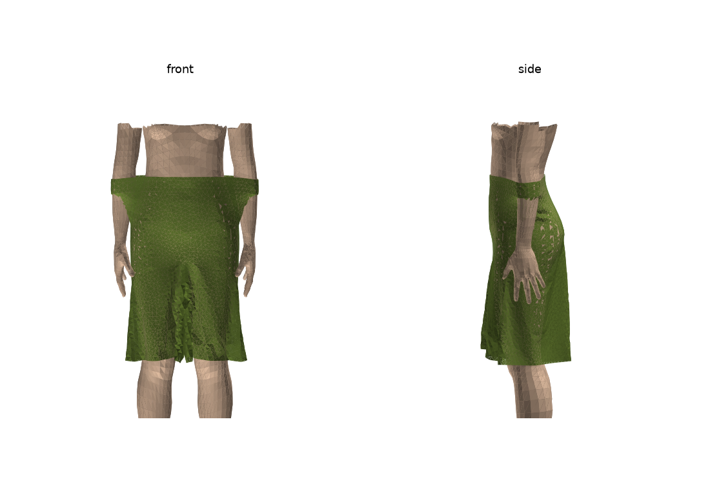

# GarmentCode 試驗：幼童軍女仔裙褲（v33 第二輪，另開，唔影響主線）

用戶：「開始第二輪，GarmentCode 另開實驗，唔好阻住主線。」目標：只試裙褲；用 MakeHuman 身體（唔用 SMPL）、CPU 模擬；唔得就放棄。

## 結果

| 步驟 | 結果 |
|---|---|
| `pip install pygarment`（2.0.2） | 裝到，但 wheel 唔齊（模組平放，`pygarment.*` import 失敗）→ 改用 repo 源碼（`PYTHONPATH`）。冇 `libcairo` → 假 `cairosvg`（只係 PNG 紙樣用）。 |
| 紙樣（`Pants`：長 0.35、闊 1.45、喇叭 1.2 + `StraightWB`） | ✅ 2–3 秒，`culottes_pattern.svg`。腰圍、臀圍用 MakeHuman 幼童軍女仔實量（68.5／71.9 cm）。 |
| 箱網格（BoxMesh，CGAL 三角化） | ✅ CPU，約 4 秒，5,308 頂點。 |
| 模擬引擎（`NvidiaWarp-GarmentCode` 1.0.0-beta.6） | ✅ 自己 build：`build_lib.py --no_standalone --quick`（g++，冇 CUDA）；CPU JIT 要嘅 `warp-clang.so` 喺 NVIDIA packman 下載唔到 → 借 PyPI `warp-lang==1.0.0` wheel 入面嗰個，用得。 |
| 模擬（MakeHuman 幼童軍女仔，米、腳喺 0；分區由 `regions.bin` 生成） | ✅ 300 步、215 秒（2 CPU）；冇自身相交；身體相交 113 處（手垂直壓住裙側）。冇 EGL → 唔用 pyrender 出圖，改 matplotlib。 |

## 評估

- **得**：真模擬出嚟有布嘅垂墜同褲襠摺（右圖側面似真裙褲），唔使 GPU，2–4 分鐘一件。
- **未得**：
  - 腰頭擺位用 GarmentCode 自己嘅身體比例（平均成年女人 × 縮放），喺 MakeHuman 細路身上偏高偏闊；要逐個身形調量度（腰線、臀線、褲襠深）。
  - GarmentCode 嘅身體係 A-pose（手打開 45°）；我哋制服企姿手垂直 → 手同裙側相交。要先用 A-pose 模擬，再跟骨骼放低手（同 MakeHuman rig 對接）。
  - 冇弓字褶（box pleat）、冇袋、冇肩帶、冇企領恤衫 → 制服其他部分始終要自己做。
  - 每個身形 × 每件衫褲要離線 bake（10 個身形），資料再加約 0.3–0.8 MB／件。
- **結論**：技術上行得通（CPU 都得），但要變成「比而家好睇」仲要做：A-pose → 制服企姿、按身形量度、自己加弓字褶。建議主線繼續用 MakeHuman 衫褲；如果之後想褲／裙更真，可以考慮用 GarmentCode 離線 bake 裙褲同褲（只 bake 幾何，唔 ship GarmentCode 身體）。

## 授權

- GarmentCode、NvidiaWarp-GarmentCode：MIT（Warp 本身 NVIDIA Source Code License，只喺本機 build 用，冇入 repo）。
- **冇用、亦冇入 repo** GarmentCode 附帶嘅 SMPL 衍生身體（非商用）。身體用 MakeHuman CC0（`public/models/mannequin/`）。

## 重做

`scripts/`：`warp_build.sh`（build 引擎）、`spike.py`（淨紙樣）、`sim.py`（紙樣 → 箱網格 → 模擬，`STEPS=300`）、`plot.py`（出圖）。
要先 `python3 -m venv /tmp/gcv && /tmp/gcv/bin/pip install pygarment`，GarmentCode 源碼解壓到 `/tmp/gc`。
